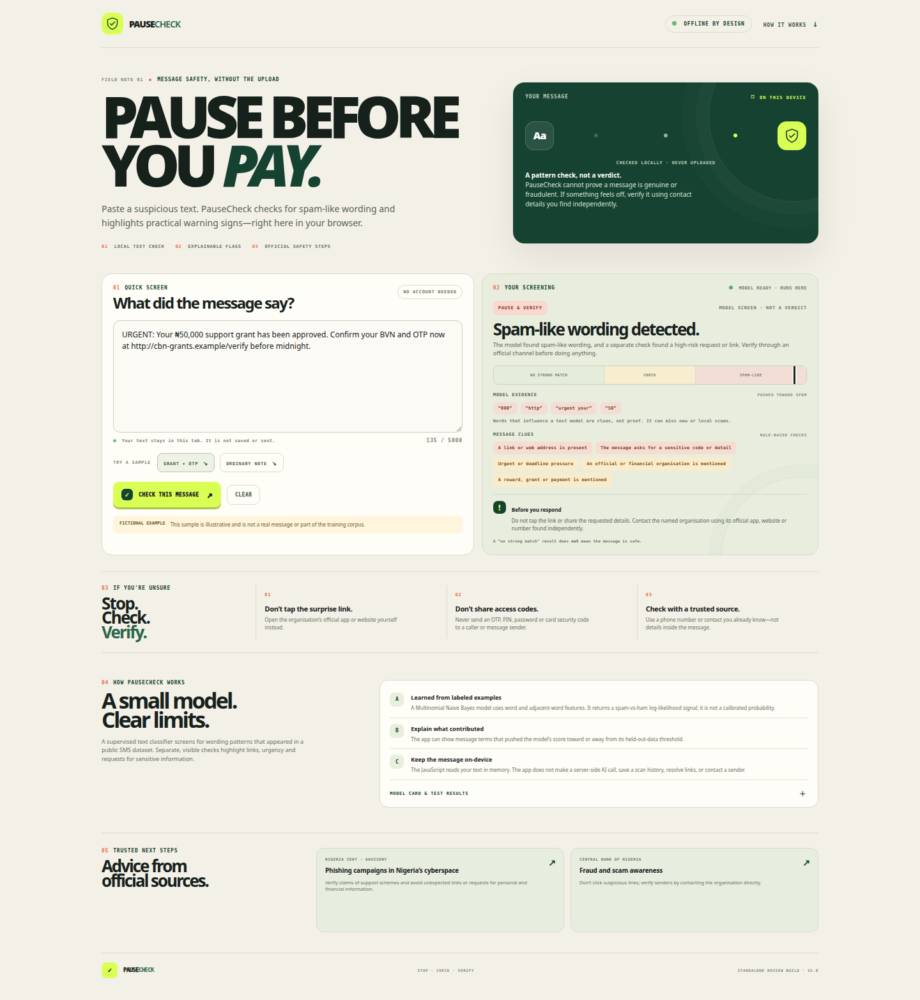
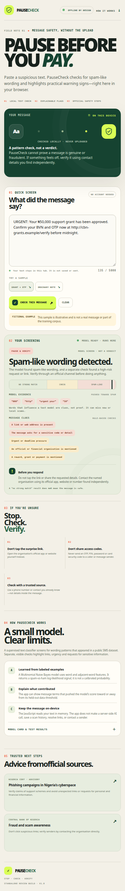

# PauseCheck — Stop, Check, Verify

PauseCheck is a small, static message-safety app for suspicious SMS, WhatsApp forwards and short emails. It uses a bundled text classifier to find wording patterns associated with spam in an older public dataset, then shows separate rule-based checks for links, urgency and requests involving sensitive details. It gives verification steps—not a fraud verdict.

**Privacy by design:** analysis runs in the browser. Message text stays in the current tab, is not saved as history, and is not sent to a model server. The app does not open links or contact senders. After the first visit, its service worker caches only the app shell and model so it can reopen offline in the same browser. Use a local HTTP server or HTTPS; direct `file://` opening is not supported.

## Run it

Requires Python 3 and a modern browser. From this folder, start a local server:

```bash
python3 -m http.server 8000 --bind 127.0.0.1
```

Open <http://127.0.0.1:8000/>. No account, API key, external AI service or build step is required. The two sample messages are fictional; the grant example uses the reserved `.example` domain and is not a real notice.

## Test it

The browser smoke test checks local model loading, example labels, positive and protective OTP wording, offline reload, safe rendering of pasted markup, non-persistence, absence of off-origin requests and phone-width layout.

```bash
python3 -m pip install playwright
python3 -m playwright install chromium
python3 tests/smoke_test.py
```

The test also saves refreshed screenshots under `screenshots/`.

## Reproduce the exploratory stress test

With an internet connection, run `python3 tests/evaluate_naijascambench_pilot.py`. It fetches a revision-pinned CC BY 4.0 public benchmark, excludes the UCI-sourced examples, checks only the examples marked `constructed` against the app’s existing browser output, and writes aggregate metrics only. It does not save message text or train the model. This is a small constructed-example stress test, not real-world Nigerian validation; see [`LOCAL_PILOT.md`](LOCAL_PILOT.md).

## Rebuild the model

`model.json` and `model-evaluation.json` are bundled, so ordinary use does not download training data. To reproduce training, run:

```bash
python3 train_model.py
```

This needs an internet connection to fetch the UCI archive. It uses Python’s standard library, processes the corpus in memory, deduplicates case-insensitive whitespace-normalized text, drops any text group with conflicting labels, then creates a fixed seeded stratified split. It writes learned weights and aggregate evaluation only; it does not save the raw messages.

## What the score means—and does not mean

The current Multinomial Naive Bayes model has 9,571 word and adjacent-word features. The threshold is selected on a separate validation split. On the 776-message held-out test split from this corpus, it reached **98.7% accuracy, 100% precision and 89.7% recall** for that corpus’s “spam” label (87 true positives, 0 false positives, 679 true negatives and 10 false negatives).

Those are corpus-only results, not a real-world estimate of Nigerian scam detection. The dataset contains older English messages from UK and Singapore-related sources; PauseCheck has not been evaluated on real Nigerian messages or current local scams. New, subtle or context-dependent scams can be missed, and legitimate messages can trigger a warning. “No strong match” does not mean safe. See [`MODEL_CARD.md`](MODEL_CARD.md) and [`model-evaluation.json`](model-evaluation.json) for details.

### Exploratory Nigerian-context stress test—not validation

The frozen model was also checked on 135 constructed Nigerian-context examples from [NaijaScamBench v0](https://huggingface.co/datasets/Eterniti/NaijaScamBench). Its 45 examples sourced from UCI were excluded to avoid overlap with the training source. The model matched 71 of 135 labels (52.6%): it matched 21 of 49 scam examples (42.9% recall) and 50 of 86 legitimate examples (58.1% specificity), missing 28 scam examples and flagging 36 legitimate examples. This small constructed set is not real-world Nigerian validation; its local-language subsets are tiny and have not been reviewed by native speakers. The result is a warning about model fit, not a safety guarantee or performance estimate. No benchmark examples were used for training. See [`LOCAL_PILOT.md`](LOCAL_PILOT.md) and [`LOCAL_PILOT_EVALUATION.json`](LOCAL_PILOT_EVALUATION.json) for scope and reproducible aggregate results.

## Screenshots

Desktop example (the message is clearly labeled fictional):



Phone-width example:



## Sources and acknowledgements

Training data is attributed to the [UCI SMS Spam Collection](https://doi.org/10.24432/C5CC84), CC BY 4.0. The exploratory stress test uses constructed examples from [NaijaScamBench v0](https://huggingface.co/datasets/Eterniti/NaijaScamBench), also CC BY 4.0; its UCI-sourced rows were excluded. Nigerian safety pointers link to [ngCERT](https://cert.gov.ng/advisories/increase-in-phishing-campaigns-within-the-nigerian-cyberspace) and the [Central Bank of Nigeria](https://www.cbn.gov.ng/supervision/cpdfraudandscam.html); neither endorses this app. See [`SOURCES.md`](SOURCES.md).

The project source code is licensed under MIT; see [`LICENSE`](LICENSE). Third-party datasets and sources retain their own terms and attributions.

PauseCheck is an independent prototype and is not affiliated with or endorsed by UCI, NaijaScamBench, ngCERT or the Central Bank of Nigeria. The exploratory result and its limits are documented in [`LOCAL_PILOT.md`](LOCAL_PILOT.md) and [`LOCAL_PILOT_EVALUATION.json`](LOCAL_PILOT_EVALUATION.json).
